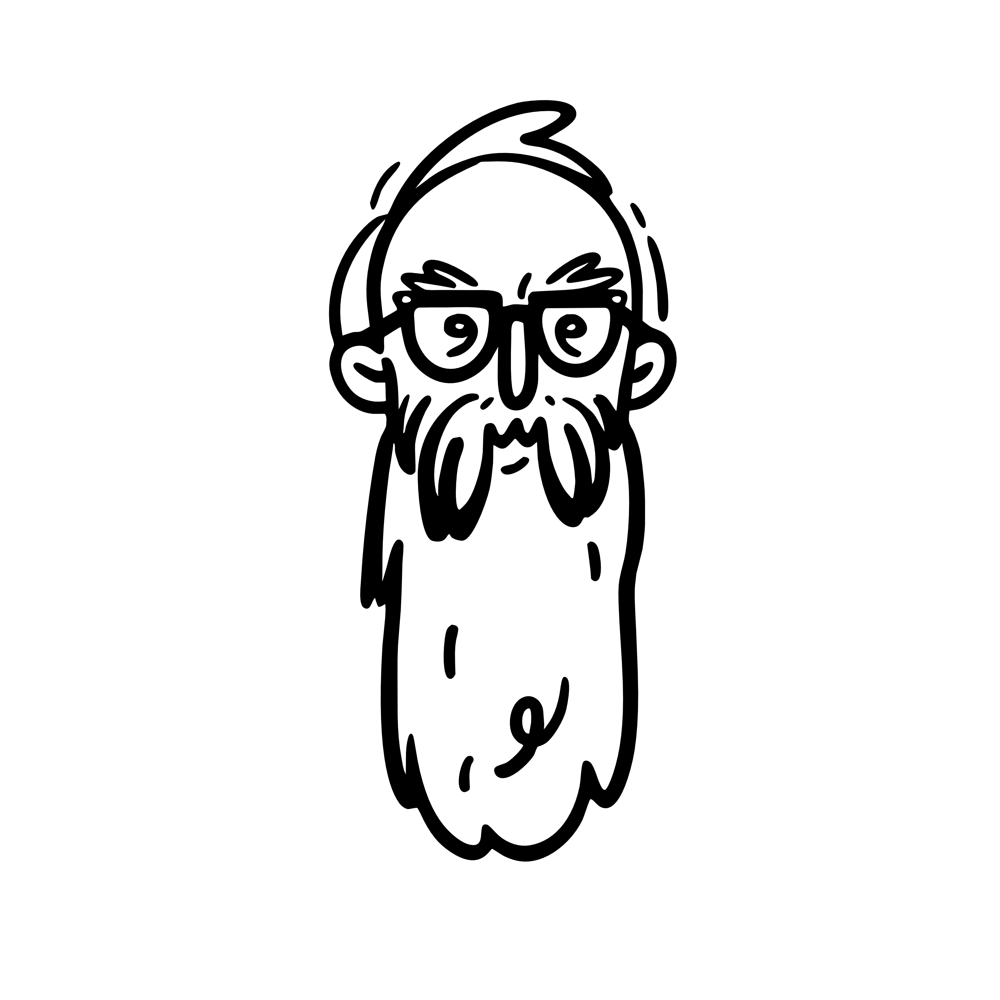

<div align="center">
  
  <h1>Long Beard</h1>
  <p><strong>Designs like an Art director. Codes like a senior.</strong></p>
</div>

You show him a ticket. He has been shipping longer than the ticket has existed.\ 
He keeps a short kit, and he drops a piece the day it stops earning its place.

Long Beard is a starting point for the agents you already use — Cursor, Claude Code, and the rest.\ 
One block in `AGENTS.md`, and a short list of skills, so the code stays small and the page is actually designed.\ 
Two commands: `init`, then later `update`.

It is not an agent runtime.\ 
It is not a marketplace.\ 
It does not replace the commands you already use, or the skills you add yourself.\  
It is a base. You keep going from here.

## Install

In a project, from GitHub:

```bash
npm install --save-dev github:jonanderdev/longbeard
npx longbeard init
```

`init` installs the list, writes the `AGENTS.md` block, and records it in `beard-lock.json`. In a terminal it asks which agents. When it cannot ask, it installs for Cursor and Claude Code. `--yes` skips the question. `--agent cursor` sets them (repeat it to add another). `--global` installs for every project on this machine. `--all` includes the optional skill.

## Update

```bash
npx longbeard update
```

That brings this project up to the Long Beard already installed: new skills, a fresh copy of the ones this command installed, and the `AGENTS.md` block.\ 
A skill you edited stays, unless you pass `--force`. Skills you installed on your own are left alone.\ 
To get a newer Long Beard, run the install line again, then update.

`npx skills update` refreshes a skill file too. It does not add a skill that is new to this list, and it does not rewrite the note. For that, install the latest Long Beard and run `npx longbeard update`.

## This project

The kit lives here. Growing it is a change in this repository. A project can skip a piece, or add one that belongs only to that work. Do not copy `beard.json` into the project. That would fork the kit.

Skip one:

```bash
npx longbeard remove web-design-guidelines
```

Add one:

```bash
npx longbeard add https://github.com/someone/skills --skill their-skill --author TheirName --why "One sentence."
```

That writes `beard.local.json`. Commit it if clones of this repo should get the extra. `npx longbeard list` shows the kit, then what this project added or skipped.

## The kit

Two of these are ours. The others are installed from the people who wrote them, and `npx longbeard update` pulls a fresh copy.

| Skill | What it is for | Author |
| --- | --- | --- |
| [ponytail](https://github.com/DietrichGebert/ponytail) | The smallest change that finishes the job | DietrichGebert |
| [premortem](https://github.com/joetawil7/first-pass/tree/main/skills/premortem) | Before the code, where this change can break | GeorgeT |
| [design-reference-hunt](skills/design-reference-hunt/SKILL.md) | No official look yet. Finds references and writes the board | Long Beard |
| [design-taste-frontend](https://github.com/Leonxlnx/taste-skill) | Builds the page from that board | Leonxlnx |
| [figma-design-to-code](https://github.com/figma/mcp-server-guide/tree/main/skills/figma-design-to-code) | Builds from a Figma file. Needs the Figma connection | Figma |
| [web-design-guidelines](https://github.com/vercel-labs/agent-skills/tree/main/skills/web-design-guidelines) | Accessibility and interface rules, when you ask for a review | Vercel |
| [design-md](skills/design-md/SKILL.md) | Follows `DESIGN.md` when the project this is installed in has one | Long Beard |
| [image-to-code](https://github.com/Leonxlnx/imagegen-skills/tree/main/skills/image-to-code) | Optional, with `--all`. Generates a picture, then builds the page from it | Leonxlnx |

A skill for one stack belongs in the project that uses that stack. The list `init` installs is [`beard.json`](beard.json).

Building Long Beard itself: read [`PRODUCT.md`](PRODUCT.md) first.
