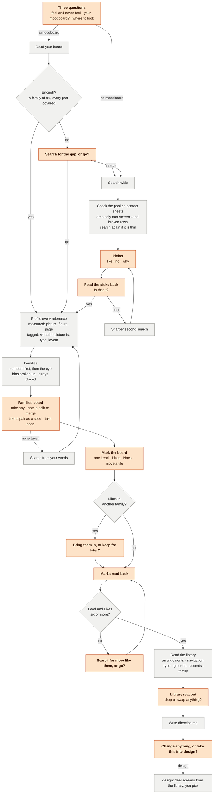

# How design direction works

From what you like to a library of what your references use. Orange steps are yours: nothing moves past them until you answer. Grey steps are the agent's.

What each file holds, all in `design-exploration/<slug>/`, which stays on your machine:

| File | What it is |
|---|---|
| `profiles.json` | Everything known about each reference: its measured picture and page, and the agent's tags |
| `families.json`, `board.md` | The families, most typical first, and the cards the boards are built from |
| `library.json` | What your Lead and Likes use, measured, with nothing chosen |
| `direction.md` | The subject, feel, voice, what to leave, the family, and the references for other parts |

"Go" or "you choose" at any orange step lets the agent decide that step, and it says what it chose.
